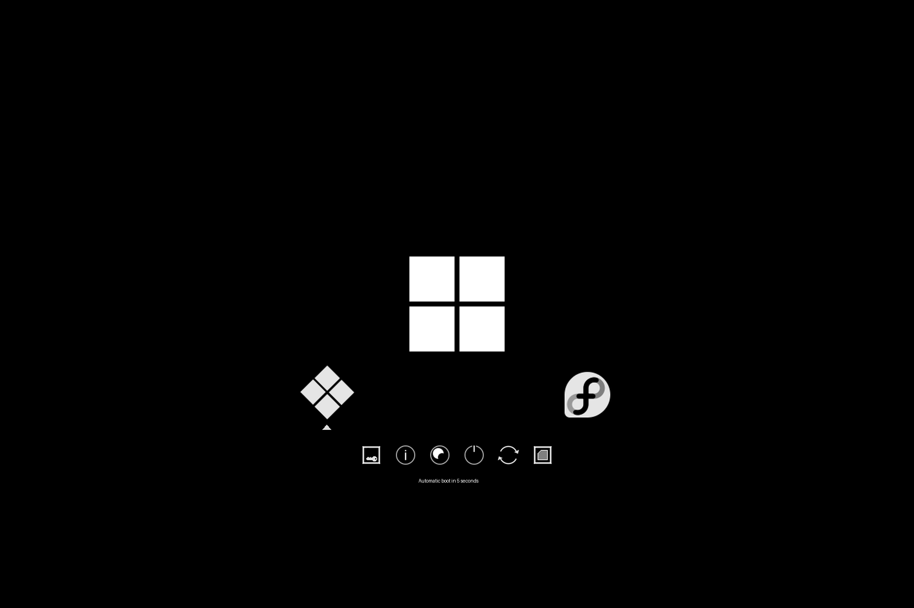

# Surface Go 3 + Fedora: issues found & fixed

A running log of problems I hit running Fedora Linux on a **Microsoft Surface Go 3**, with what
caused them and how I fixed or worked around each one. Everything uses the **stock Fedora kernel**
(no linux-surface) with Secure Boot on, dual-booting Windows 11 via rEFInd.

| | |
|---|---|
| Device | Surface Go 3 (Pentium Gold 6500Y, 8 GB, 1920×1280 touchscreen, Type Cover `045e:09b5`) |
| OS | Fedora 45 Workstation, GNOME 51 (Wayland), kernel 7.3 |
| Boot | rEFInd 0.14.2 → shim (Secure Boot) → GRUB / Windows Boot Manager |

<p align="center"><br>
<sub>rEFInd boot menu with a dark theme that matches the firmware splash (mock-up). <a href="issues/refind-dual-boot.md">Details</a></sub></p>

## Index

Status: ✅ fixed / worked around · ⚠️ open · ℹ️ not a bug

### Hardware & power
| Issue | Status |
|---|---|
| [Type Cover touchpad stalls suspend 10 s (`usbhid suspend error -5`)](issues/typecover-sleep-eio.md) | ✅ sleep hook |
| [Type Cover touchpad dead after boot / login, keys dead after attach](issues/typecover-dead-after-boot.md) | ✅ USB reset at login (testing) / ⚠️ re-attach |
| [USB-C won't charge when plugged in after booting on battery (`ucsi_acpi PPM init failed`)](issues/charging-hotplug.md) | ⚠️ magnetic charger, or shut down + power on |
| [Auto-brightness jumps around in dim light](issues/auto-brightness-pumping.md) | ✅ extension |
| [Auto-rotate off with cover attached / stuck after resume](issues/auto-rotate.md) | ℹ️ / ✅ |
| [Volume rocker doesn't repeat when held (`intel-hid`)](issues/volume-rocker-hold.md) | ✅ DKMS patch |
| [Cameras](issues/cameras.md) | ℹ️ work on stock kernel |
| [Touchscreen misses taps on the couch](issues/touchscreen-dead-spots.md) | ℹ️ grounding |

### Boot & dual boot
| Issue | Status |
|---|---|
| [rEFInd dark theme, Windows black-screen handoff, shim `.sbat` warning, backup/restore](issues/refind-dual-boot.md) | ✅ |
| [Clock 11 h off after dual boot](issues/dual-boot-clock.md) | ✅ |
| [Fedora 44 → 45 upgrade notes (GNOME 51 extension API breaks)](issues/fedora45-upgrade.md) | ✅ |

### Desktop
| Issue | Status |
|---|---|
| [On-Screen Touchpad extension: GNOME 51 port + grabbed the Type Cover touchpad](issues/onscreen-touchpad.md) | ✅ patch |
| [On-screen keyboard (Tabula OSK), dock + TouchUp gestures, power tweaks](issues/desktop-tweaks.md) | ✅ patch |
| [Chrome loses profile sign-in (oo7 secret service)](issues/chrome-signin-keyring.md) | ✅ autologin off |

## Fix files
```
fixes/
├── sleep/50-surface-typecover-touchpad     systemd sleep hook → /usr/lib/systemd/system-sleep/
├── login/                                  Type Cover USB reset at login (script + unit)
├── volume-rocker/                          intel-hid hold-repeat patch + DKMS install.sh
├── rotate/                                 restart iio-sensor-proxy after resume
├── touchup/dash-to-dock-v110.patch         TouchUp ↔ Dash to Dock v110 fix
├── brightness/                          Smooth Brightness extension + install.sh
├── refind/                                 dark theme.conf, install/backup/restore scripts
└── onscreen-touchpad/                      helper patch, uinput udev rule
```
Read the matching write-up before installing anything. All of these were tested on this one machine only.

## Useful commands
```sh
journalctl -b -k | grep -Ei 'usbhid|ucsi|suspend'         # kernel side of most issues here
journalctl -b -1 -k                                        # previous boot
sudo libinput debug-events                                 # does input reach evdev at all?
upower -i $(upower -e | grep BAT)                          # charging state
cat /sys/power/suspend_stats/last_hw_sleep                 # s2idle residency (µs)
```

## License
Scripts: [MIT](LICENSE). Write-ups: CC BY 4.0.
